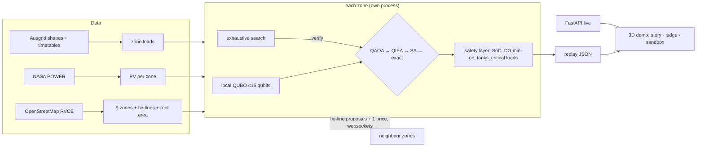

# Q-Grid — decentralised, QAOA-verified scheduling for the RVCE campus microgrid

EUREKA Track 3 · Smart Decentralised Energy Systems


> QAOA on a local simulator: verified against exact solutions, no quantum advantage claimed.
> QIEA = quantum-inspired evolutionary algorithm on a classical CPU (not quantum computing).

**Data status:** real NASA POWER irradiance, Ausgrid household shapes (hostels), OpenStreetMap layout (© OpenStreetMap
contributors). **PENDING:** KERC/BESCOM tariff (PENDING), IEX prices (PENDING), CEA CO2 factor, RVCE calendar
and meter data — labelled stand-ins, never headline results. See `data/SOURCES.md`, `docs/BLOCKERS.md`, `docs/data_request.md`.

## The problem (status quo, from results/*.csv)
BESCOM outage during the fest evening: status quo **3.00 h** of critical-load downtime,
6.0 DG hours, Rs 153,499 for the day (stand-in prices).

## Result
| Outage during fest (scenario A) | Status quo | Q-Grid | Central optimum (B4) |
|---|---:|---:|---:|
| Critical-load downtime (h) | 3.00 | **2.50** | 0.00 |
| Cost (Rs/day) | 153,499 | 161,911 | 161,702 |
| DG hours | 6.00 | 5.75 | – |
| Re-plan time per slot | – | 1.044 s | – |

30-day evaluation set (scenario A, mean Rs/day): status quo 166,645 · per-zone MILP 161,686 ·
**Q-Grid 162,163** (7.63 % above optimum) · central optimum 156,919.
QAOA answers verified optimal in 66.0 % of local solves (rest: QIEA / annealing / exact fallback).
Full tables: [docs/results.md](docs/results.md).

## Architecture


## How to run
```bash
conda activate qgrid && make install
make test                      # pytest
make demo                      # frontend (+ live backend on :8000); frontend alone works offline
make data && make qaoa && make bench && make replay   # full pipeline (~20 min on a MacBook)
make verify                    # recompute headline numbers, PASS/FAIL vs results/manifest.json
bash scripts/refresh_all.sh    # after adding the PENDING files
python scripts/new_campus.py --name "<campus>" --lat <lat> --lon <lon>   # another campus
```

## Status
| Step | What | State |
|---|---|---|
| 0–5 (v1) | generic 5-building pipeline, kept in docs/results_v1.md | ✅ |
| 1 | pricing scenarios A (headline) / B (sensitivity), SOURCES with page numbers when REAL | ✅ code · data PENDING |
| 2 | RVCE campus from OSM, timetable/Ausgrid loads, DG, tanks, outage islanding, 6 scenarios | ✅ (calendar/loads PENDING) |
| 3 | QAOA only on scenarios, warm start, QUBO cache, ADMM convergence stats & fallbacks | ✅ |
| 4 | QAOA → QIEA → SA → exact tiers, C-QIEA, baselines B0–B5, benchmark both price scenarios | ✅ |
| 5 | plain-English operator rules (guarded) + deterministic explanations | ✅ |
| 6 | replay export | ✅ |
| 7 | 3D demo: story (6 chapters), judge/review, what-if sandbox, honesty strip, recording | ✅ |
| 8 | new_campus.py, manifest + make verify, CI | ✅ |
| 9 | report, why-quantum, viva Q&A, pitch, data request | ✅ |

## Honest limits
PENDING prices/CO2/calendar/meter data; loads are area-based estimates; perfect forecasts; QAOA simulated (ideal, noiseless);
ADMM with binaries has no convergence guarantee (full agreement in 48.7 % of slots, rest settled safely);
lossless tie-lines without AC power flow. Docs: [report](docs/report.md) · [why quantum](docs/why_quantum.md) ·
[viva Q&A](docs/viva_qa.md) · [pitch](docs/pitch.md) · [QUBO derivation](docs/qubo.md).

## Credits
The QIEA solver tier and the LLM rule-guard idea were inspired by RVCE team ReZero's *Q-Route* project. Map data
© OpenStreetMap contributors (ODbL). Ausgrid Solar Home Electricity Data (CC BY 3.0 AU). NASA POWER (NASA LaRC).
