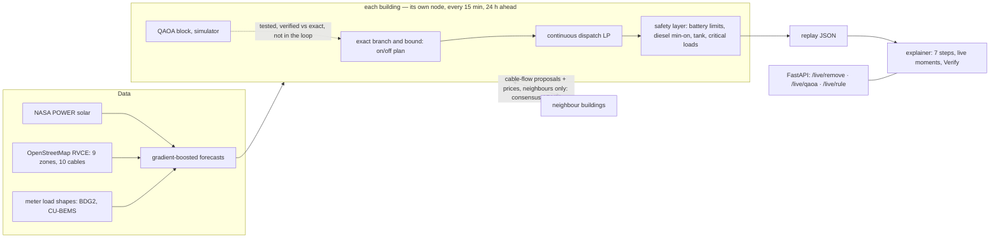

# Q-Grid — decentralised scheduling for a campus solar + battery microgrid

EUREKA Track 3 · Smart Decentralised Energy Systems · RVCE, Bengaluru


**Q-Grid cuts critical downtime from 16 min to 8 min a day (0 min counting only shortfalls above 1 %), saves 3.3% on the bill versus today, and lands 0.8% from the best possible plan.** When the campus network fails for 3 hours, central control loses 3.5 points of gap and Q-Grid 2.1, because each building keeps optimising on its own.

> QAOA on a local simulator: verified against exact solutions, no quantum advantage claimed.
> Tariffs and the CO₂ factor are labelled stand-ins (PENDING the official documents); Rs figures are not headline results.
> Every number in this README is rendered from `results/` by `scripts/write_results_md.py`.

**Data status:** real NASA POWER irradiance, Ausgrid household shapes (hostels), OpenStreetMap layout (© OpenStreetMap
contributors), KERC Tariff Order 2023 (BESCOM HT-2(c)(ii) with ToD, Rs 350/kVA demand charge, 3.74 Rs/kWh export) and
CEA CO2 factor v20.0 (0.727 tCO2/MWh, FY2023-24). **PENDING:** IEX prices, RVCE calendar and meter data — labelled
stand-ins, never headline results. **The Rs figures below were computed with the earlier stand-in tariff and will change
when results are regenerated with the KERC 2023 tariff.** See `data/SOURCES.md`, `docs/BLOCKERS.md`, `docs/data_request.md`.

## Open the demo

- **Live link:** `⟨paste the Vercel URL here after deploying⟩` — static build, offline replay, no backend needed.
- **Locally:** `cd frontend && npm install && npm run dev` → <http://localhost:5173>. Press **P** for presenter mode,
  **D** for dark mode, ← → to move through the seven steps.
- **With the live backend** (the three live moments compute on the spot): `make backend` in a second terminal; the top bar
  turns to **Live backend**.
- **Deploy your own:** import the repo in Vercel with root directory `frontend` (`frontend/vercel.json` sets
  `npm run build:static`, output `dist`). Or `cd frontend && npm run build:static` and serve `dist/` from any static host.
- **Backup video (90 s):** [docs/media/backup_demo.webm](docs/media/backup_demo.webm) · **one-page summary:** the
  "Download summary (PDF)" button in the demo.

## The problem

Today each building runs on its own: critical loads lose power 16 min a day and the bill is Rs 177,985 a day.

## Results (scorecard: 30 RVCE days, same data, forecasts and constraints for every method)

| Method | Gap to best plan % | Certified gap % | Bill saving vs today %* | Critical downtime h/day | …counting >1 % shortfalls | Works without a central controller |
|---|---:|---:|---:|---:|---:|:---:|
| Status quo (no coordination) | 28.73 | 28.73 | 0.0 | 0.26 | 0.26 | ✓ |
| Rule-based battery controller | 35.75 | 35.76 | 2.6 | 0.26 | 0.26 | ✓ |
| Particle swarm optimisation | 23.55 | 23.55 | 1.3 | 0.26 | 0.26 | ✓ |
| Per-building MPC (MILP) | 21.70 | 21.70 | 1.1 | 0.26 | 0.26 | ✓ |
| Central MPC with forecasts | 1.86 | 1.86 | 2.5 | 0.09 | 0.01 | ✗ |
| Central MPC, 3 h network failure | 5.36 | 5.36 | 2.3 | 0.11 | 0.03 | ✗ |
| **Q-Grid** | **0.76** | **0.76** | **3.3** | **0.14** | **0.00** | ✓ |
| Q-Grid, 3 h network failure | 2.87 | 2.87 | 2.5 | 0.16 | 0.03 | ✓ |
| _Best possible plan (central MILP, perfect information; reference)_ | _0.02_ | _0.02_ | _5.1_ | _0.00_ | _0.00_ | — |

\* stand-in tariff (PENDING). Across 5 campuses (RVCE + four public meter datasets), Q-Grid is the closest
method without a central controller on 4. Full tables with ± and 95 % intervals, Wilcoxon verdicts:
[docs/benchmark_v3.md](docs/benchmark_v3.md) · consistency checks: [docs/consistency.md](docs/consistency.md).

**Is it worth it?** Node hardware ≈ Rs 7.9 lakh for 9 buildings (assumed costs); bill
saving ≈ Rs 20.8 lakh/year; extra battery wear ≈ Rs 1.9 lakh/year
(every optimiser prices wear in its objective). Payback ≈ 0.4 years; 10-year NPV Rs 113.1
lakh (Monte Carlo P5–P95: Rs 71.0 to 158.1 lakh). Assumptions and sources:
[docs/impact.md](docs/impact.md).

## Architecture



RVCE is modelled as 9 zones (buildings or building groups) joined by 10 cables. No central computer at runtime: each building solves its own commitment exactly and agrees cable flows with its neighbours
(convex LP, consensus ADMM). If the network fails, buildings keep optimising alone. Faculty rules in plain English are parsed,
validated and priced before they can touch a schedule.

## How to run

```bash
conda activate qgrid && make install
make test                                  # pytest (backend) ; cd frontend && npm run test:contrast  (WCAG AA, both themes)
make demo                                  # frontend + live backend on :8000 (the frontend alone works offline)
python scripts/run_bench_v3.py             # scorecard benchmark (5 datasets x 30 days x 10 methods; ~10 h on 8 workers)
python scripts/write_bench_v3.py && python scripts/write_consistency.py && python scripts/write_impact.py
make replay && python scripts/make_live.py # replay JSON + precomputed live moments for the offline demo
python scripts/write_results_md.py         # re-render README and docs from results/
make verify                                # recompute headline numbers, PASS/FAIL vs results/manifest.json
```

## Data sources and pending items

| Source | Use | Status |
|---|---|---|
| NASA POWER (NASA LaRC) | solar irradiance, Bengaluru | real |
| OpenStreetMap (© contributors, ODbL) | campus layout, roof areas | real |
| Building Data Genome 2 (CC BY-SA 4.0) | load shapes for 7 of the 9 RVCE zones; three other campuses in the benchmark | real |
| CU-BEMS (CC BY 4.0) | fifth campus in the benchmark (Bangkok office building) | real |
| Ausgrid Solar Home Electricity Data (CC BY 3.0 AU) | earlier hostel load shape (superseded by BDG2) | real |
| KERC Tariff Order 2023 (BESCOM HT-2(c)(ii)) + KERC FY24 solar order | energy tariff with ToD, demand charge, export rate | real source — **results below not yet regenerated** (category and ≥ 500 kVA ToD: ASSUMPTION) |
| IEX day-ahead prices | sensitivity scenario | **PENDING** — PENDING |
| CEA CO₂ Baseline Database v20.0 | grid emission factor 0.727 tCO₂/MWh (FY2023-24) | real |
| RVCE meter data, calendar, asset list | loads, day types, battery/diesel sizes | **PENDING** — area-based estimates |

Licences, URLs and fetch dates: `data/SOURCES.md` · what we asked RVCE for: `docs/data_request.md`.

## Pitch materials

[3-minute script](docs/pitch_3min.md) · [1-minute script](docs/pitch_1min.md) · [Q&A prep: 20 hardest questions](docs/qa_prep.md) ·
[demo runbook](docs/demo_runbook.md) · [impact](docs/impact.md) · [why quantum](docs/why_quantum.md)

## Team and faculty guide

- **Team lead:** Yashas (GitHub: Yojan-ui)
- **Team members:** ⟨add names⟩
- **Faculty guide:** ⟨add name, department⟩
- RV College of Engineering, Bengaluru

## Honest limits

- No quantum advantage: QAOA is simulated (ideal, noiseless) and is not in the control loop; it was tested and verified.
- Tariff and CO₂ factor are now official (KERC 2023, CEA v20.0), but the Rs figures above were computed with the earlier stand-in tariff and change when results are regenerated. RVCE loads, calendar and asset sizes are stand-ins until the documents arrive.
- Outages and network failures in the benchmark are synthetic (seeded). Cables are modelled as lossless, without AC power flow.
- Battery wear is priced with an assumed battery cost and cycle life; real warranty data will change the rate.
- Value of lost load (Rs 40 / 1,000 per kWh) is an assumption; every gap is also reported without it.
- Feeder-scale operation is a plan, not a result.

## Credits

The QIEA solver tier and the LLM rule-guard idea were inspired by RVCE team ReZero's *Q-Route* project. Map data
© OpenStreetMap contributors (ODbL). Ausgrid Solar Home Electricity Data (CC BY 3.0 AU). NASA POWER (NASA LaRC).
BDG2 and CU-BEMS under their published licences (see `data/SOURCES.md`).
