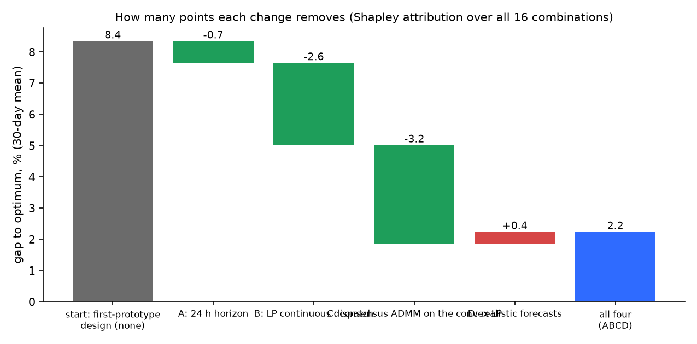

# Ablation study — which change removes how much of the gap

> QAOA on a local simulator: verified against exact solutions, no quantum advantage claimed. No quantum solver is used in the ablation: every master problem is solved exactly (HiGHS branch and bound) so the factors are measured without solver noise.

_Generated by `scripts/run_ablation.py` from `results/ablation/*.csv`; do not edit numbers by hand._

## Setup

- 30 evaluation days (the 30-day set), identical data, days, constraints and objective for every combination; loads from BDG2 meter shapes, solar from NASA POWER; prices are the PENDING stand-in tariff (A).
- Every combination re-plans every hour (4 slots) and applies the first hour; the realised schedule is settled by `model.settle()`. Objective = energy + diesel fuel + value of lost load + terminal value of stored energy and water (the central MILP's objective). Peak kVA is reported, not optimised.
- Branch and bound gets the same budget in every combination: 0.5 s and a 1 % gap per building solve; `B&B limit hits` counts solves that stopped at the time limit (incumbent used).
- Factors: **A** = 24 h horizon (vs 1 h); **B** = LP continuous dispatch (vs discretised kW); **C** = consensus ADMM on the convex LP (vs binary ADMM); **D** = realistic forecasts (vs perfect).
- Under C (consensus ADMM on the LP) cable flows are continuous, because ADMM needs a convex problem; without B and without C, flows use the first prototype's discrete levels {−120, 0, +120} kW.
- 1 h horizon (no A) uses the first prototype's per-zone cost-to-go (dynamic programming over the day on its own forecast) as the terminal value of the battery.

## How many points each change removes

Shapley attribution: each factor's average marginal effect over all orders in which the four changes could be added (exact, from the 16 cells; the contributions sum to the total change from none to all four).

| Factor | gap-to-optimum, points | critical downtime, h | peak, kVA | grid import, kWh |
|---|---:|---:|---:|---:|
| A: 24 h horizon (vs 1 h) | -0.70 | +0.00 | -40 | -697 |
| B: LP continuous dispatch (vs discretised kW) | -2.63 | +0.00 | -50 | -711 |
| C: consensus ADMM on the convex LP (vs binary ADMM) | -3.19 | +0.00 | +133 | -946 |
| D: realistic forecasts (vs perfect) | +0.41 | +0.00 | -0 | +135 |

## All 16 combinations (30-day means)

| Combination | gap % | certified gap % | critical downtime h | critical unserved kWh | grid import kWh | peak kVA | DG litres | solar self-consumption % | curtailment kWh | plan time s | ADMM converged | B&B limit hits |
|---|---:|---:|---:|---:|---:|---:|---:|---:|---:|---:|---:|---:|
| A+C | 9.13 | 9.13 | 0.00 | 0.0 | 20,308 | 1,858 | 85.2 | 83.9 | 0.0 | 5.04 | 100 % | 86.1 |
| A+C+D | 8.69 | 8.69 | 0.00 | 0.0 | 20,467 | 1,897 | 72.3 | 83.2 | 0.0 | 6.00 | 100 % | 81.7 |
| B+D | 8.42 | 8.42 | 0.00 | 0.0 | 21,383 | 1,791 | 0.0 | 78.7 | 0.0 | 1.65 | 3 % | 0.0 |
| D | 8.41 | 8.41 | 0.00 | 0.0 | 22,375 | 1,934 | 0.0 | 77.8 | 0.0 | 1.54 | 100 % | 0.0 |
| none (first-prototype design) | 8.35 | 8.35 | 0.00 | 0.0 | 22,358 | 1,950 | 0.0 | 77.9 | 0.0 | 0.04 | 100 % | 0.0 |
| B | 8.20 | 8.20 | 0.00 | 0.0 | 21,330 | 1,800 | 0.0 | 79.3 | 0.0 | 0.18 | 3 % | 0.0 |
| A | 7.35 | 7.35 | 0.00 | 0.0 | 21,118 | 1,806 | 4.4 | 80.3 | 0.0 | 3.54 | 100 % | 38.5 |
| A+D | 7.33 | 7.33 | 0.00 | 0.0 | 21,173 | 1,786 | 1.1 | 80.1 | 0.0 | 4.57 | 100 % | 35.0 |
| A+B+D | 5.95 | 5.96 | 0.00 | 0.0 | 20,938 | 1,868 | 0.0 | 81.8 | 0.0 | 5.91 | 0 % | 0.0 |
| A+B | 5.39 | 5.39 | 0.00 | 0.0 | 20,819 | 1,863 | 0.0 | 82.8 | 0.0 | 4.84 | 0 % | 0.1 |
| C+D | 4.44 | 4.44 | 0.00 | 0.0 | 21,469 | 2,146 | 0.0 | 83.6 | 0.0 | 1.55 | 100 % | 0.0 |
| B+C+D | 4.31 | 4.31 | 0.00 | 0.0 | 20,249 | 1,871 | 0.0 | 85.2 | 0.0 | 1.55 | 100 % | 0.0 |
| C | 3.91 | 3.91 | 0.00 | 0.0 | 21,307 | 2,144 | 0.0 | 84.7 | 0.0 | 0.05 | 100 % | 0.0 |
| B+C | 3.51 | 3.51 | 0.00 | 0.0 | 20,024 | 1,860 | 0.0 | 86.6 | 0.0 | 0.06 | 100 % | 0.0 |
| A+B+C+D | 2.24 | 2.24 | 0.00 | 0.0 | 20,139 | 1,994 | 0.0 | 86.3 | 0.0 | 2.03 | 100 % | 0.2 |
| A+B+C | 1.22 | 1.22 | 0.00 | 0.0 | 19,874 | 1,988 | 0.0 | 88.0 | 0.0 | 1.09 | 100 % | 0.0 |

## Outage stress day (BESCOM outage 18:00–21:00 during the fest, 15 Jun 2023) — critical loads

| Combination | gap % | certified gap % | critical downtime h | critical unserved kWh | DG litres | peak kVA |
|---|---:|---:|---:|---:|---:|---:|
| none (first-prototype design) | 64.38 | 64.38 | 1.75 | 147.8 | 264.0 | 2,082 |
| A | 60.89 | 60.89 | 1.50 | 139.2 | 305.2 | 1,942 |
| D | 57.79 | 57.79 | 1.50 | 127.1 | 280.5 | 2,129 |
| A+C+D | 50.18 | 50.18 | 2.75 | 112.4 | 379.5 | 1,996 |
| A+D | 43.12 | 43.12 | 2.00 | 93.8 | 247.5 | 1,936 |
| C+D | 19.73 | 19.73 | 3.00 | 36.1 | 297.0 | 1,763 |
| B+D | 16.02 | 16.02 | 2.00 | 20.5 | 238.7 | 2,052 |
| A+C | 13.63 | 13.63 | 1.25 | 12.1 | 346.5 | 2,210 |
| B | 12.40 | 12.40 | 1.50 | 11.8 | 226.8 | 2,078 |
| C | 12.32 | 12.32 | 1.25 | 17.9 | 297.0 | 1,815 |
| A+B+D | 7.71 | 7.71 | 1.75 | 9.1 | 296.7 | 2,024 |
| B+C+D | 6.11 | 6.11 | 2.00 | 2.1 | 297.0 | 1,773 |
| A+B | 5.38 | 5.38 | 1.50 | 4.6 | 295.1 | 1,996 |
| B+C | 3.60 | 3.60 | 1.00 | 0.7 | 284.7 | 2,109 |
| A+B+C+D | 2.73 | 2.73 | 3.00 | 2.0 | 297.0 | 2,320 |
| A+B+C | 1.68 | 1.68 | 1.00 | 0.5 | 297.0 | 2,310 |

## Lower bounds (per day, proven)

Mean over days: LP relaxation is 0.004 % below the central optimum, the Lagrangian bound 0.066 %, and the MILP's own dual bound 0.0005 %. Certified gap = (our cost − best bound) / best bound; see docs/math.md for what is proven and what is measured.

## Forecast error (factor D, held-out evaluation days, forecasts issued hourly, lead 15 min – 24 h)

- Solar: MAE 152 kW (campus), nMAE 10.3 % (1 h 9.2 %, 1–4 h 9.9 %, 4–24 h 10.4 %).
- Load: MAE 31 kW (campus), nMAE 2.2 % (1 h 1.9 %, 4–24 h 2.3 %).
- Gradient-boosted trees trained on other 2023 days (held-out days excluded); BDG2 zone shapes are medians over many buildings and NASA POWER irradiance is hourly and satellite-derived, so both are smoother than a single real meter — real forecast errors would be larger.

## Limitations

- 30 days, not 365 (the full year will be run when RVCE data is available); one price scenario (stand-in).
- Loads are BDG2 shapes scaled by floor area × EPI (PENDING RVCE meters); see data/SOURCES.md.
- Discrete-dispatch combinations hit the branch-and-bound time limit more often; their gap includes that.
