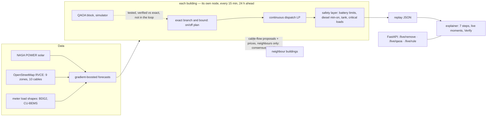

# Q-Grid — decentralised scheduling for a campus solar + battery microgrid

EUREKA Track 3 · Smart Decentralised Energy Systems · RVCE, Bengaluru


**{{headline.sentence}}**

{{q3.story.comms}} (Mean of {{hl.n_days|0}} modelled RVCE days, {{hl.n_outage_days|0}} with a synthetic BESCOM outage;
locked headline and its table: [docs/headline.md](docs/headline.md).)

> QAOA on a local simulator: verified against exact solutions, no quantum advantage claimed.
> Tariff: BESCOM HT-2(c)(ii) from the KERC Tariff Order 2022 (days before 1 April 2023) and the KERC Tariff Order 2023
> (from 1 April 2023), both verified against the official PDFs. CO₂: CEA baseline 0.727 t/MWh (verified). RVCE loads,
> battery, EV chargers and cables are stand-ins or proposals and are labelled; see [docs/data_verification.md](docs/data_verification.md).
> Every number in this README is rendered from `results/` by `scripts/write_results_md.py`.

## Open the demo

- **Live link:** `⟨paste the Vercel URL here after deploying⟩` — static build, offline replay, no backend needed.
- **Locally:** `cd frontend && npm install && npm run dev` → <http://localhost:5173>. Press **P** for presenter mode,
  **D** for dark mode, ← → to move through the seven steps.
- **With the live backend** (the three live moments compute on the spot): `make backend` in a second terminal; the top bar
  turns to **Live backend**.
- **Deploy your own:** import the repo in Vercel with root directory `frontend` (`frontend/vercel.json` sets
  `npm run build:static`, output `dist`). Or `cd frontend && npm run build:static` and serve `dist/` from any static host
  (Windows PowerShell: `$env:VITE_QGRID_OFFLINE=1; npm run build`). Check it with `npx vite preview` → <http://localhost:4173>.
  The replay files the build ships are `frontend/public/replay/*.json`, copied there by the result scripts.
- **Backup video (90 s):** [docs/media/demo_backup.webm](docs/media/demo_backup.webm) · **one-page summary:** the
  "Download summary (PDF)" button in the demo.

## The problem

{{q3.story.step1}}

## Results (scorecard: {{q3.story.n_days|0}} RVCE days, same data, forecasts and constraints for every method)

| Method | Gap to best plan % | Certified gap % | Bill saving vs today %* | Critical downtime h/day | …counting >1 % shortfalls | Works without a central controller |
|---|---:|---:|---:|---:|---:|:---:|
| Status quo (no coordination) | {{q3.b.rvce.status_quo.gap_pct|2}} | {{q3.b.rvce.status_quo.certified_gap_pct|2}} | {{q3.b.rvce.status_quo.saving_pct|1}} | {{q3.b.rvce.status_quo.critical_downtime_h|2}} | {{q3.b.rvce.status_quo.critical_downtime_1pct_h|2}} | ✓ |
| Rule-based battery controller | {{q3.b.rvce.rule_based.gap_pct|2}} | {{q3.b.rvce.rule_based.certified_gap_pct|2}} | {{q3.b.rvce.rule_based.saving_pct|1}} | {{q3.b.rvce.rule_based.critical_downtime_h|2}} | {{q3.b.rvce.rule_based.critical_downtime_1pct_h|2}} | ✓ |
| Particle swarm optimisation | {{q3.b.rvce.pso.gap_pct|2}} | {{q3.b.rvce.pso.certified_gap_pct|2}} | {{q3.b.rvce.pso.saving_pct|1}} | {{q3.b.rvce.pso.critical_downtime_h|2}} | {{q3.b.rvce.pso.critical_downtime_1pct_h|2}} | ✓ |
| Per-building MPC (MILP) | {{q3.b.rvce.per_building_mpc.gap_pct|2}} | {{q3.b.rvce.per_building_mpc.certified_gap_pct|2}} | {{q3.b.rvce.per_building_mpc.saving_pct|1}} | {{q3.b.rvce.per_building_mpc.critical_downtime_h|2}} | {{q3.b.rvce.per_building_mpc.critical_downtime_1pct_h|2}} | ✓ |
| Central MPC with forecasts | {{q3.b.rvce.central_mpc.gap_pct|2}} | {{q3.b.rvce.central_mpc.certified_gap_pct|2}} | {{q3.b.rvce.central_mpc.saving_pct|1}} | {{q3.b.rvce.central_mpc.critical_downtime_h|2}} | {{q3.b.rvce.central_mpc.critical_downtime_1pct_h|2}} | ✗ |
| Central MPC, 3 h network failure | {{q3.b.rvce.central_mpc_comms_fail.gap_pct|2}} | {{q3.b.rvce.central_mpc_comms_fail.certified_gap_pct|2}} | {{q3.b.rvce.central_mpc_comms_fail.saving_pct|1}} | {{q3.b.rvce.central_mpc_comms_fail.critical_downtime_h|2}} | {{q3.b.rvce.central_mpc_comms_fail.critical_downtime_1pct_h|2}} | ✗ |
| **Q-Grid** | **{{q3.b.rvce.qgrid.gap_pct|2}}** | **{{q3.b.rvce.qgrid.certified_gap_pct|2}}** | **{{q3.b.rvce.qgrid.saving_pct|1}}** | **{{q3.b.rvce.qgrid.critical_downtime_h|2}}** | **{{q3.b.rvce.qgrid.critical_downtime_1pct_h|2}}** | ✓ |
| Q-Grid, 3 h network failure | {{q3.b.rvce.qgrid_comms_fail.gap_pct|2}} | {{q3.b.rvce.qgrid_comms_fail.certified_gap_pct|2}} | {{q3.b.rvce.qgrid_comms_fail.saving_pct|1}} | {{q3.b.rvce.qgrid_comms_fail.critical_downtime_h|2}} | {{q3.b.rvce.qgrid_comms_fail.critical_downtime_1pct_h|2}} | ✓ |
| _Best possible plan (central MILP, perfect information; reference)_ | _{{q3.b.rvce.optimum.gap_pct|2}}_ | _{{q3.b.rvce.optimum.certified_gap_pct|2}}_ | _{{q3.b.rvce.optimum.saving_pct|1}}_ | _{{q3.b.rvce.optimum.critical_downtime_h|2}}_ | _{{q3.b.rvce.optimum.critical_downtime_1pct_h|2}}_ | — |

\* BESCOM HT-2(c)(ii) (KERC Tariff Orders 2022 and 2023), energy charge plus the day's share of the monthly demand charge at
{{hl.contract_kva|0}} kVA contract demand (assumed). Across {{q3.n_campuses|0}} campuses (RVCE + four public meter datasets), Q-Grid is the closest
method without a central controller on {{q3.best_on_n|0}}. Full tables with ± and 95 % intervals, Wilcoxon verdicts:
[docs/benchmark_v3.md](docs/benchmark_v3.md) · consistency checks: [docs/consistency.md](docs/consistency.md).

**Is it worth it?** {{imp.sentence}} Assumptions and sources: [docs/impact.md](docs/impact.md).

**What should RVCE build next?** The investment planner (Plan tab, `scripts/plan_investment.py`) sizes extra rooftop
solar per roof group, a battery and the contract demand with one linear programme over the 30 RVCE days at the real
tariff. Today: {{plan.existing_kwp|0}} kWp, contract {{plan.base_contract_kva|0}} kVA, energy + demand + diesel ≈ Rs
{{plan.base_cost_lakh|1}} lakh/year. The cost-minimising plan adds {{plan.extra_kwp|0}} kWp and a {{plan.battery_kwh|0}} kWh
battery at {{plan.contract_kva|0}} kVA contract: investment ≈ Rs {{plan.capex_lakh|1}} lakh, saving ≈ Rs
{{plan.saving_lakh|1}} lakh/year, {{plan.payback_text}}. PV and battery costs are ASSUMPTIONS (quotes
pending) and operation is planned with perfect information, so this is an upper bound on savings.

## Architecture



RVCE is modelled as 9 zones (buildings or building groups) joined by 10 cables. No central computer at runtime: each building solves its own commitment exactly and agrees cable flows with its neighbours
(convex LP, consensus ADMM). If the network fails, buildings keep optimising alone. Faculty rules in plain English are parsed,
validated and priced before they can touch a schedule.

## How to run

```bash
conda activate qgrid && make install
make test                                  # pytest (backend) ; cd frontend && npm run test:contrast  (WCAG AA, both themes)
make demo                                  # frontend + live backend on :8000 (the frontend alone works offline)
python scripts/run_bench_v3.py --workers=8 # scorecard benchmark (5 datasets x 30 days x 10 methods + design rows; ~3 h on a 24-thread laptop)
python scripts/write_bench_v3.py && python scripts/write_consistency.py && python scripts/write_impact.py
make replay && python scripts/make_live.py # replay JSON + precomputed live moments for the offline demo
python scripts/write_results_md.py         # re-render README and docs from results/
make verify                                # recompute headline numbers, PASS/FAIL vs results/manifest.json
```

## Data sources and pending items

| Source | Use | Status |
|---|---|---|
| NASA POWER (NASA LaRC) | solar irradiance, Bengaluru | real |
| OpenStreetMap (© contributors, ODbL) | campus layout, roof areas | real |
| Building Data Genome 2 (CC BY-SA 4.0) | load shapes for 7 of the 9 RVCE zones; three other campuses in the benchmark | real |
| CU-BEMS (CC BY 4.0) | fifth campus in the benchmark (Bangkok office building) | real |
| Ausgrid Solar Home Electricity Data (CC BY 3.0 AU) | earlier hostel load shape (superseded by BDG2) | real |
| KERC Tariff Orders 2023 and 2022 (BESCOM), HT-2(c)(ii) | energy charge, ToD, demand charge, billing demand | verified (TO-2023 p.199–206, 365–373; TO-2022 p.404–412) — {{price_A_status}} |
| KERC solar tariff order, 01.06.2023 | rooftop PV export rate Rs 3.74/kWh | verified (p.30) |
| IEX day-ahead prices | sensitivity scenario | **PENDING** — {{price_B_status}} |
| CEA CO₂ Baseline Database v20/v21 | grid emission factor 0.727 t/MWh | verified |
| RVCE team brief | 500.48 kWp on 21 roofs, 67,721 m² built-up, 38,659 m² hostels, 2 × 490 kVA diesel | team brief (estate data pending) |
| RVCE meter data, calendar | loads, day types | **PENDING** — area-based estimates |

Licences, URLs and fetch dates: `data/SOURCES.md` · what we asked RVCE for: `docs/data_request.md`.

## Pitch materials

[locked headline](docs/headline.md) · [judge brief: the project in plain words](docs/judge_brief.md) · [3-minute script](docs/pitch_3min.md) · [1-minute script](docs/pitch_1min.md) ·
[Q&A prep: 20 hardest questions](docs/qa_prep.md) · [deck outline](docs/deck_outline.md) · [demo runbook](docs/demo_runbook.md) ·
[impact](docs/impact.md) · [why quantum](docs/why_quantum.md) · [real-data review](docs/review_real_data.md) ·
[RVCE data request email](docs/rvce_data_request_email.md)

## Status

- **Real-data pass (branch `real-data`):** campus rescaled to the team brief (500.48 kWp on 21 roofs, 2 × 490 kVA diesel);
  BESCOM HT-2(c)(ii) tariff verified against the KERC Tariff Orders 2022 and 2023 and the KERC solar order; CEA CO₂ factor
  verified; five-campus scorecard, replays and docs regenerated from it.
- **Planner fix (28 Nov):** Q-Grid's campus peak budgets no longer starve a building that planned no import in a slot
  (the cause of batteries charging at the 18:00 peak); every Q-Grid row re-run with the same seeds
  ([docs/review_real_data.md](docs/review_real_data.md)).
- **Waiting on RVCE:** one BESCOM HT bill (contract demand, recorded maximum demand), which buildings the two diesel sets
  back, diesel logs, meter data. See [docs/rvce_data_request_email.md](docs/rvce_data_request_email.md).
- **Proposed, not on campus today:** batteries, EV chargers, inter-building cables.

## Team and faculty guide

- **Team lead:** Yashas (GitHub: Yojan-ui)
- **Team members:** ⟨add names⟩
- **Faculty guide:** ⟨add name, department⟩
- RV College of Engineering, Bengaluru

## Honest limits

- No quantum advantage: QAOA is simulated (ideal, noiseless) and is not in the control loop; it was tested and verified.
- RVCE loads and calendar are stand-ins until meter data arrives; solar, diesel and floor areas are from the team brief.
- Battery, EV chargers and inter-building cables do not exist on campus today: they are PROPOSED, and labelled so.
  Q-Grid's outage gain comes from sharing the two diesel sets' power with buildings that have none, so on campus it
  depends on which buildings those sets can actually feed (asked of the estate office).
- No real bill saving: on normal days the bill is {{hl.normal_abs_pct|1}} % {{hl.normal_dir}} than today's practice, over
  all days {{hl.all_abs_pct|1}} % {{hl.all_dir}} (diesel burned in outages to keep critical loads up), and the nodes do not
  pay back on the bill. A planner defect found in the full run (batteries charged at the 18:00 peak, 24 Feb 2023) was
  fixed and every Q-Grid row re-run (docs/review_real_data.md).
- Tariff: RVCE's billing category (HT-2(c)(ii)) and its contract demand (1,300 kVA assumed) need one RVCE BESCOM bill to confirm.
- Outages and network failures in the benchmark are synthetic (seeded). Cables are modelled as lossless, without AC power flow.
- Battery wear is priced with an assumed battery cost and cycle life; real warranty data will change the rate.
- Value of lost load (Rs 40 / 1,000 per kWh) is an assumption; every gap is also reported without it.
- Feeder-scale operation is a plan, not a result.

## Credits

The QIEA solver tier and the LLM rule-guard idea were inspired by RVCE team ReZero's *Q-Route* project. Map data
© OpenStreetMap contributors (ODbL). Ausgrid Solar Home Electricity Data (CC BY 3.0 AU). NASA POWER (NASA LaRC).
BDG2 and CU-BEMS under their published licences (see `data/SOURCES.md`).
